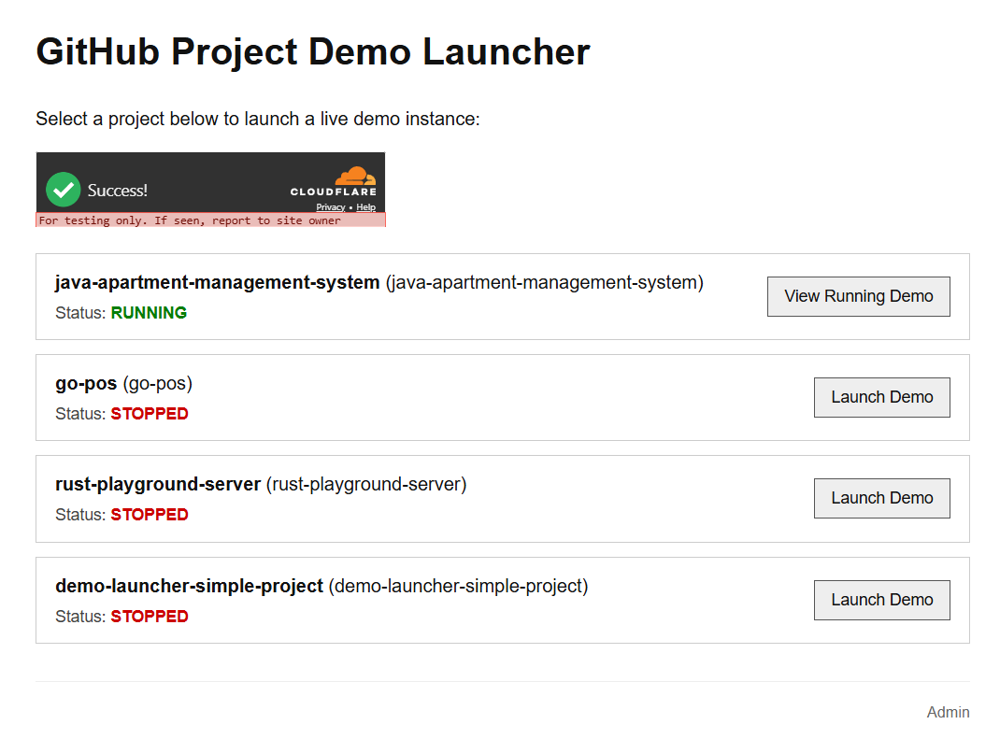
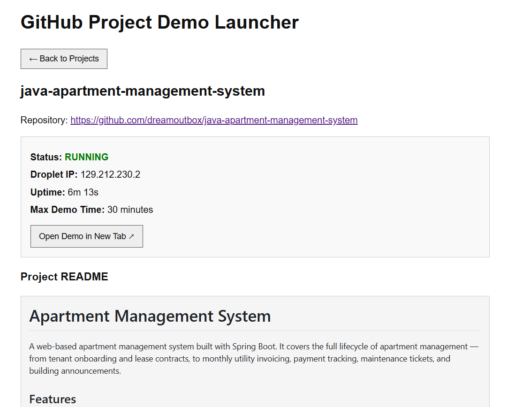
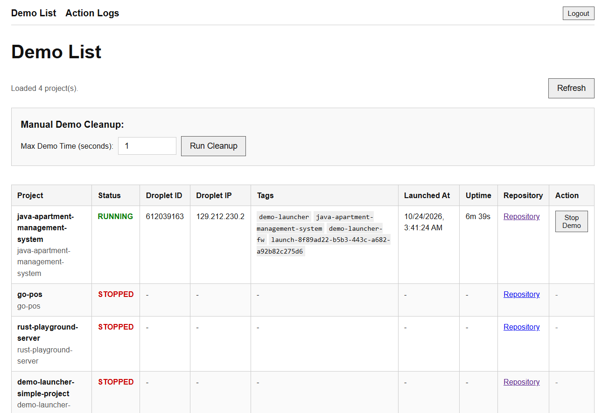
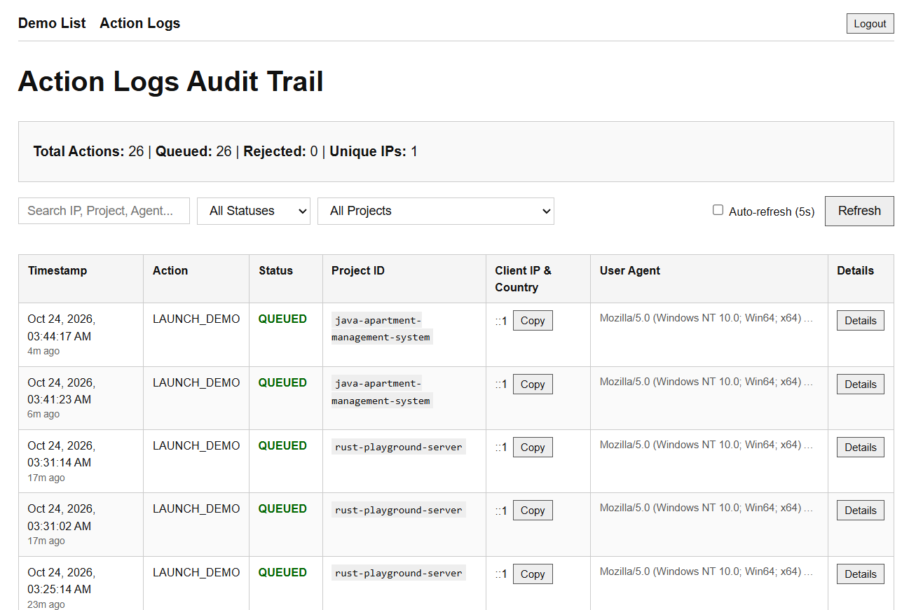

# Demo Launcher

Demo Launcher is a Cloudflare Worker application for showcasing projects by starting temporary DigitalOcean droplets on demand. The Worker serves a small web interface, queues launch requests with Cloudflare Queues, stores demo status in D1, and creates or deletes droplets through the DigitalOcean API.

Each demo is stopped after one hour. A scheduled Worker runs every five minutes, so cleanup can happen up to about five minutes after that limit.

## Demo Images









## Requirements

- Node.js and pnpm
- A Cloudflare account with Workers, Queues, and D1 enabled
- Wrangler authenticated to that account (`npx wrangler login`)
- A DigitalOcean account and API token for deployed demos
- `jq` if using the included local test scripts

## Configure Projects

Edit [`src/projects.json`](src/projects.json) and replace the example GitHub URLs with the repositories you want to showcase. The repositories must be publicly cloneable by a new droplet. At startup, the droplet clones the repository and runs `demo-launcher-entrypoint.sh` from its root if present; otherwise, it serves a basic placeholder page with Nginx.

## Deploy

Before deploying, run `./dev-setup-remote.sh` to provision remote Cloudflare resources and configure required production secrets:

```sh
pnpm install
./dev-setup-remote.sh
```

`dev-setup-remote.sh` performs the following setup:
1. Creates remote queues (`demo-launcher-queue` and `my-queue-dlq`).
2. Creates the remote D1 database (`mydb`), applies [`schema.sql`](schema.sql), and verifies the `project_demos` table.
3. Guides and prompts you to configure production secrets:
   - `TURNSTILE_SITE_KEY`: Cloudflare Turnstile public site key.
   - `TURNSTILE_SECRET_KEY`: Cloudflare Turnstile secret key for server-side token validation.
   - `DO_API_KEY`: DigitalOcean Personal Access Token with read/write droplet permissions.

If a new D1 database was created, update the `database_id` for `mydb` in [`wrangler.jsonc`](wrangler.jsonc) to that database ID before deploying.

For real DigitalOcean provisioning, set `ENVIRONMENT` to `production` in the top-level `vars` section of `wrangler.jsonc`:

```jsonc
"vars": {
	"ENVIRONMENT": "production"
}
```

Deploy the Worker and static assets:

```sh
./dev-deploy.sh
```

The production service creates Ubuntu 24.04 droplets in DigitalOcean region `sgp1` using size `s-1vcpu-1gb`. Adjust these values in [`src/digitalocean.prod.ts`](src/digitalocean.prod.ts) or via `wrangler.jsonc` vars if needed. DigitalOcean account limits and billing apply.

### Firewall & Tags

Every newly launched droplet is automatically tagged with `['demo-launcher', <projectId>, <firewallTag>]`. Before creating a droplet, the Worker ensures the DigitalOcean tag and cloud firewall exist (default name and tag: `demo-launcher-fw`). DigitalOcean automatically attaches the firewall to any droplet carrying that tag.

- **Inbound rules:** TCP ports 22, 80, 443 and ICMP from `0.0.0.0/0` and `::/0`.
- **Outbound rules:** All TCP, UDP, and ICMP traffic to any destination.
- **Environment overrides:** Set `DO_FIREWALL_NAME` and `DO_FIREWALL_TAG` in `wrangler.jsonc` or `.dev.vars` to customize the firewall name and tag.

### Database Migrations

Fresh installations create tables with the complete schema defined in [`schema.sql`](schema.sql). For existing databases, `./dev-migrate.sh [--local|--remote]` checks whether table columns (such as `tags` and `attempt_id` on `project_demos`) already exist and applies idempotent schema updates from [`migrations-manual/`](migrations-manual/). Both `./dev-setup-local.sh` and `./dev-setup-remote.sh` run `./dev-migrate.sh` automatically.

## Run Locally

Initialize local D1 database schema and run the dev server:

```sh
./dev-setup-local.sh
pnpm dev
```

Open `http://localhost:8787`. Local development runs with mock DigitalOcean droplets and bypasses remote Turnstile verification. The included `dev-test-manually.sh` runs a local end-to-end check; it requires `jq` and initializes the local D1 database itself.

## Use the App

Open the deployed Worker URL to browse the configured projects and request a demo. The Worker also exposes:

- `GET /api/projects` returns projects and current demo statuses.
- `POST /api/launch` accepts JSON such as `{"projectId":"awesome-shop-demo"}` and queues a launch request.
- `GET /api/cron-cleanup` manually runs cleanup only in development. An optional `maxDemoTimeSeconds` query parameter sets the expiration threshold for testing.

The launch endpoint responds with `202 Accepted`; provisioning continues asynchronously in the queue. Launching is split into two queue phases: `CREATE` persists the droplet id immediately, then `POLL_HEALTH` resolves the public IP and runs the health check. Queue retries resume an interrupted attempt, and `CREATE` finds an already-created droplet through its `launch-<attemptId>` tag. Non-retryable DigitalOcean 4xx responses, such as a droplet limit error, mark the demo `FAILED` and acknowledge the message instead of retrying. The UI polls project status until the droplet IP is available. Demos are publicly reachable at their droplet IP, so only add repositories suitable for public demonstration.
